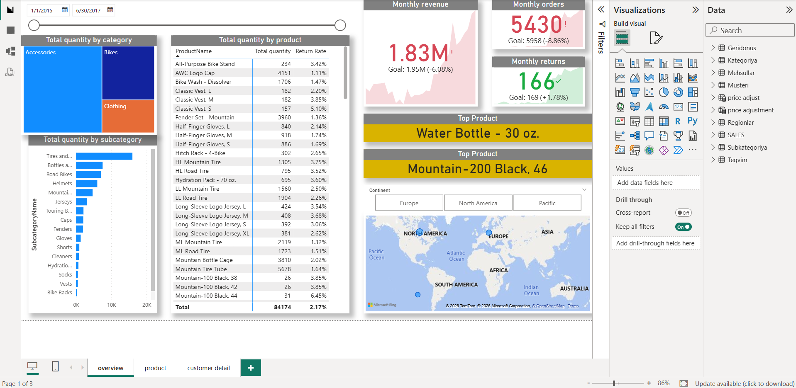
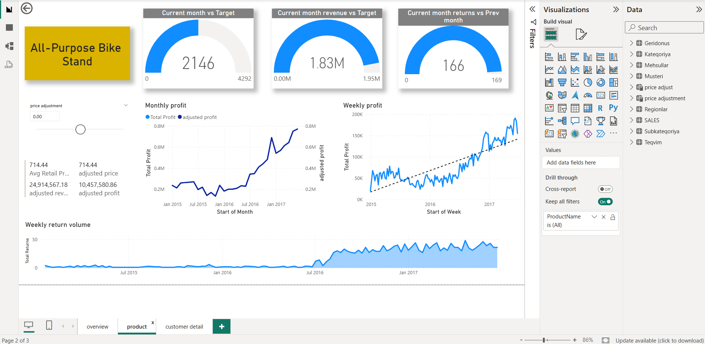

# Retail Sales Analytics | Power BI

## Project Overview

This project presents an interactive Power BI dashboard designed to analyze retail sales performance, product profitability, and customer behavior. It provides valuable business insights through data visualization, KPI monitoring, and performance analysis.

## Dashboard Pages

### 1. Overview
- Total Revenue and Orders
- Sales performance by product categories and subcategories
- Monthly sales trends
- Product returns analysis
- Geographic sales distribution
- Top-selling products

### 2. Product Analysis
- Product profitability analysis
- Price adjustments and their impact
- Actual vs. target revenue
- Monthly and weekly profit trends
- Product returns comparison

### 3. Customer Analysis
- Customer segmentation by age and gender
- Orders by occupation and income level
- Customer revenue analysis
- Order distribution by customer segments
- Top customers identification

## Tools & Technologies

- Microsoft Power BI
- DAX
- Data Visualization
- Business Intelligence

## Project Objective

The main objective of this project is to transform retail sales data into meaningful insights, identify business trends, evaluate product performance, and better understand customer purchasing behavior.

## Author

**Fariz Yagublu**

[GitHub](https://github.com/yagublu23)

---

## Dashboard Preview

### 1. Overview

### 2. Product Analysis

### 3. Customer Analysis

